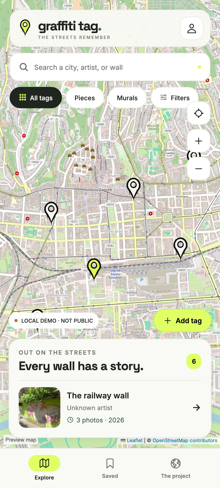
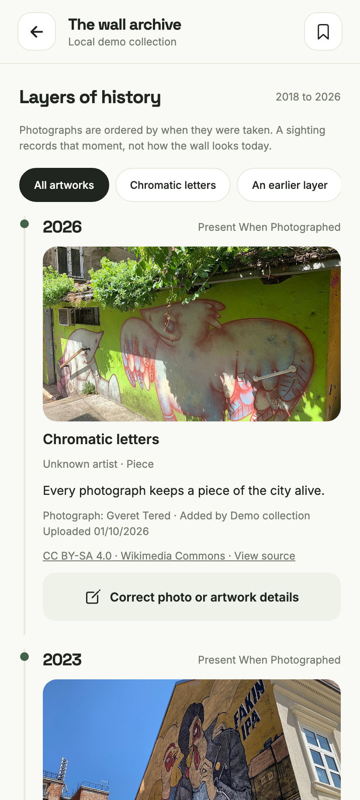
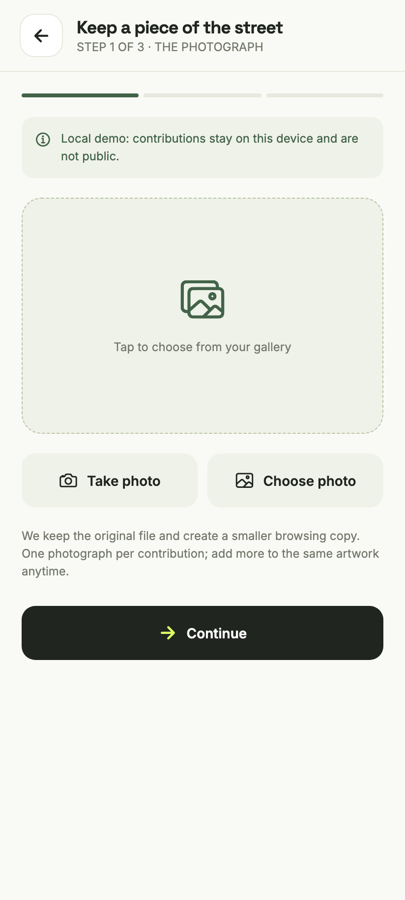

  

<h1 align="center">Graffiti Tag</h1>

A growing archive of graffiti and the walls that hold it.

  

Graffiti is a big part of culture, but walls change, buildings disappear, and art can be painted over overnight. Graffiti Tag is a map-based archive for preserving graffiti through photographs, locations, and the stories behind each piece.

The goal is a shared archive where anyone can contribute photos and information, preserving a wall’s history as different artworks come and go. A photo taken today and one from years ago both belong here.

**This project is a work in progress.** For now, the Android app works as a single-user personal archive, with photos and tags stored on your own device. A shared community archive is planned for the future.

## A look inside

Screenshots from the browser preview using sample records. Artwork dates and locations are illustrative. The Android personal archive starts empty.

| Explore the map | A wall’s history | Add a photograph |
| --- | --- | --- |
|  |  |  |

## Try the Android app

Download the APK above, open it on your Android phone, and follow the installation prompts. This is an early personal test release.

You can take or choose photos, place tags using GPS or the map, record dates, and add photographs to a wall’s history. Saved photos and records work offline. Maps and place search need internet.

Export backups from **My archive** and keep a copy outside the app. This first release supports backup files up to 50 MB. Uninstalling or clearing app data removes the local archive.

## Development

See [development notes](docs/DEVELOPMENT.md), [personal Android build instructions](personal-android/README.md), and [community setup](docs/SETUP.md).

## Photo credits

Bundled demo photographs are credited in [ATTRIBUTION.md](mobile/assets/demo/ATTRIBUTION.md). User photographs stay in each installation’s local archive.
